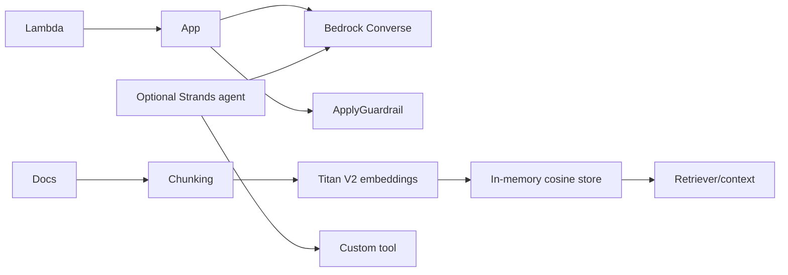

# AWS AI Engineering Toolkit

An independent community Python toolkit with small, reusable building blocks for AI applications on AWS. It is not developed, sponsored, certified, or officially maintained by Amazon Web Services.

## Features

- Bedrock Runtime client factory and structured Converse responses.
- Titan Text Embeddings V2 adapter, configurable chunking, cosine search, and an in-memory RAG retriever.
- Independent Bedrock Guardrails `ApplyGuardrail` input/output evaluation.
- Botocore Stubber contract tests, Titan payload validation, and a small deterministic Recall@K regression set.
- Optional Strands Agents custom-tool example.
- Minimal Lambda handler and AWS SAM deployment example.
- Offline unit tests; the default suite never calls AWS.

## Architecture



## Requirements and installation

Python 3.11+ and an AWS account are needed only for cloud-backed examples. Install from a checkout:

```bash
python -m venv .venv
# Windows: .venv\Scripts\Activate.ps1
# macOS/Linux: source .venv/bin/activate
python -m pip install -e ".[dev]"
```

Install the optional Strands SDK with `python -m pip install -e ".[strands]"`.

## Credentials and cost

The toolkit does not accept or store credentials. Boto3 uses its standard credential provider chain (for example, an IAM role, AWS IAM Identity Center profile, or environment-based credentials). Configure a region with `AWS_REGION` or pass `ToolkitConfig(region_name=...)`. Never commit credentials. Enable model access as required in your account and region. Grant `bedrock:InvokeModel` for Converse and Titan embeddings, scoped to the needed model or inference profile ARN; grant `bedrock:ApplyGuardrail` on the guardrail resource for independent evaluation. Bedrock requests may incur charges. Unit tests require no AWS account or network.

## Quick start

```python
from aws_ai_toolkit.bedrock import converse, create_bedrock_runtime_client
from aws_ai_toolkit.config import ToolkitConfig

client = create_bedrock_runtime_client(ToolkitConfig(region_name="us-east-1"))
reply = converse(client, "amazon.nova-micro-v1:0", "What is RAG?", max_tokens=100)
print(reply.text)
```

## Examples

Run from the repository root after `pip install -e .` and configuring AWS credentials:

```bash
python examples/bedrock-converse/main.py
python examples/rag/main.py
python examples/guardrails/main.py  # set BEDROCK_GUARDRAIL_ID
python -m pip install -e ".[strands]" && python examples/strands-agent/main.py
```

The RAG example calls Titan V2 for each chunk and query. Its in-memory vector store is educational and ephemeral, not a persistent production vector database. The Strands example also makes a model request. The Guardrails example calls `ApplyGuardrail` independently without invoking a foundation model.

The Lambda example lives at `examples/lambda/app.py`; SAM instructions are in [infrastructure/sam/README.md](infrastructure/sam/README.md). No cloud infrastructure is deployed by this project.

## Tests, contracts, and retrieval evaluation

```bash
python -m pytest
ruff check .
ruff format --check .
python -m compileall -q src examples tests
python -m pytest --collect-only -q
python scripts/validate_yaml.py
python -m build
```

The default tests are offline. Botocore `Stubber` checks modeled Bedrock request and response contracts without network calls; Titan's serialized JSON request and opaque response body are validated separately. The fixed-vector RAG sample reports Recall@K as a regression check for ranking mechanics. Its four hand-authored documents and three questions are synthetic and do not establish retrieval quality for real corpora.

Optional live checks are skipped by default and can call paid services. Review [tests/integration/README.md](tests/integration/README.md) before opting in. See [CONTRIBUTING.md](CONTRIBUTING.md) for the full contributor workflow. Limitations include in-memory-only storage, no streaming Converse abstraction, and no full multimodal request or tool orchestration support. This project has no production SLA or security certification; model access, latency, and charges vary by account and region.

## Scope and failure behavior

The toolkit packages common request construction, validation, response normalization, retry/timeout defaults, test seams, and examples around boto3. `converse` sends a single text prompt, extracts text for existing callers, and preserves all response content blocks. It does not execute model tool-use requests or accept image/audio input. Guardrails checks are independent of model calls: use `INPUT` before processing user text and `OUTPUT` before returning generated text. If evaluation errors or returns an unknown action, the helper raises; applications should fail closed and must not continue with unverified content.

## Security, support, and license

Report vulnerabilities privately as described in [SECURITY.md](SECURITY.md). See [SUPPORT.md](SUPPORT.md) for support boundaries and [CHANGELOG.md](CHANGELOG.md) for release notes. Licensed under MIT; see [LICENSE](LICENSE).
